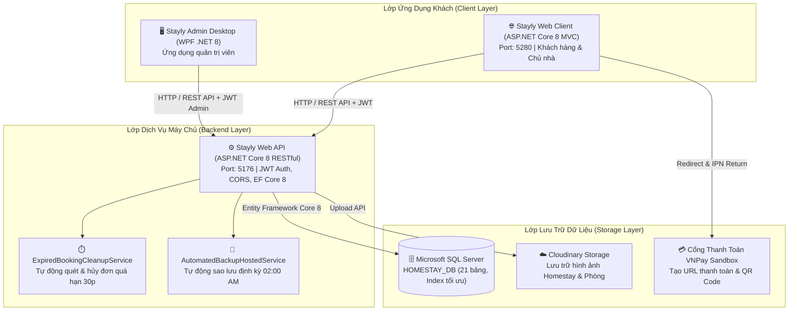

# Stayly — Nền Tảng Đặt Phòng & Quản Trị Homestay Toàn Diện

> **Đồ án / Khóa luận tốt nghiệp cử nhân**  
> **Kiến trúc hệ thống:** 3 phân hệ tích hợp (Web Khách hàng & Chủ nhà, Desktop Quản trị Admin, Backend RESTful API)  
> **Cơ sở dữ liệu:** Microsoft SQL Server (`HOMESTAY_DB`)

---

## 📌 Giới Thiệu Tổng Quan

**Stayly** là hệ sinh thái công nghệ quản lý và đặt phòng Homestay hiện đại, giải quyết trọn vẹn bài toán vận hành giữa 3 nhóm đối tượng:
1. **Khách hàng (Du khách / Guest):** Tìm kiếm homestay theo khu vực/tiện ích, xem chi tiết phòng và dịch vụ bổ sung, áp dụng mã ưu đãi, đặt phòng nhiều đêm với thanh toán VNPay-QR bảo mật cao, theo dõi trạng thái đơn hàng thời gian thực, yêu cầu hoàn tiền minh bạch và gửi đánh giá trải nghiệm.
2. **Chủ cơ sở lưu trú (Host / Owner):** Đăng ký cơ sở và phòng, cấu hình bảng giá & dịch vụ bổ sung, quản lý lịch trống/đã đặt, tiếp nhận và xét duyệt đơn khách, theo dõi doanh thu và trạng thái quyết toán hoa hồng (85% thực nhận).
3. **Quản trị viên sàn (Platform Admin):** Sử dụng ứng dụng Desktop (WPF) hiệu năng cao để kiểm duyệt pháp lý cơ sở homestay mới, giám sát toàn sàn, thực hiện đối soát quyết toán doanh thu chi trả chủ nhà (85/15), quản lý danh mục & voucher, và bảo trì an toàn hệ thống (Sao lưu & Phục hồi CSDL tự động / thủ công).

---

## 🏛️ Kiến Trúc Hệ Thống (System Architecture)



---

## 💻 Công Nghệ Sử Dụng (Technology Stack)

| Phân hệ | Công nghệ / Thư viện | Vai trò |
| :--- | :--- | :--- |
| **Backend API** | ASP.NET Core 8.0, C# 12 | Cung cấp RESTful API, phân quyền JWT Bearer, xử lý nghiệp vụ trung tâm |
| **ORM / Data** | Entity Framework Core 8.0, SQL Server 2019/2022 | Truy vấn dữ liệu, Connection Pooling, Migrations, T-SQL SMO Backup/Restore |
| **Web Client** | ASP.NET Core 8.0 MVC, Razor Views, Bootstrap 5.3, Bootstrap Icons, JavaScript Vanilla | Giao diện du khách đặt phòng và chủ nhà quản lý cơ sở lưu trú |
| **Desktop Admin**| WPF, XAML, MVVM Pattern, MaterialDesignThemes | Giao diện quản trị viên sàn: kiểm duyệt, quyết toán, bảo trì sao lưu CSDL |
| **Thanh toán** | Cổng VNPay Sandbox, VNPay-QR Code | Thanh toán điện tử thời gian thực, chữ ký số HMAC-SHA512 |
| **Lưu trữ ảnh** | Cloudinary .NET SDK | Lưu trữ, tối ưu hóa và CDN phân phối hình ảnh homestay |
| **Bảo mật** | BCrypt / ASP.NET Identity PasswordHasher, JWT Tokens, CSRF Anti-forgery | Mã hóa mật khẩu, xác thực phiên làm việc, chống giả mạo request |

---

## ✨ Các Tính Năng Nổi Bật Cốt Lõi

### 1. Luồng Đặt Phòng & Dịch Vụ Bổ Sung
- Chọn phòng theo ngày nhận (`CheckIn`) và ngày trả (`CheckOut`), kiểm tra sức chứa khách lớn/trẻ em.
- Đặt trước các **dịch vụ bổ sung** (BBQ, tiệc trà, giặt ủi, thuê xe...) với số lượng linh hoạt, tự động tính tổng tiền minh bạch.
- Hỗ trợ nhập **Mã giảm giá (Promo Code)** có kiểm tra thời hạn và mức trần giảm tối đa (`ToiDa`).
- Ngăn chặn triệt để đặt trùng phòng (Double-Booking) qua cơ chế kiểm tra lịch kép (`ChiTietDon` & `LichLuuTru`).

### 2. Thanh Toán VNPay-QR & Bộ Đếm Thời Gian Thực Tế 30 Phút
- Tạo link thanh toán VNPay và hiển thị mã QR thanh toán trực tiếp.
- **Bộ đếm thời gian thực tế 30 phút:** Tính đúng khoảng thời gian còn lại kể từ lúc tạo đơn (`NgayDat`), **không bị reset về 30:00 khi F5 / refresh trang** hay khi thoát ra vào lại sau.
- **Tự động hủy đơn quá hạn:** Nếu sau 30 phút khách không hoàn tất thanh toán, đơn tự động chuyển sang trạng thái `DaHuy` và giải phóng lịch phòng về `Trống` (qua cả Background Service chạy nền mỗi 30s và cơ chế Lazy On-Demand khi tải dữ liệu).

### 3. Chính Sách Hủy Đơn & Yêu Cầu Hoàn Tiền Minh Bạch
- Cho phép khách yêu cầu hủy & hoàn tiền trực tiếp trên trang cá nhân nếu đáp ứng chính sách lưu trú.
- Lưu trữ thông tin tài khoản ngân hàng thụ hưởng (`BankName`, `AccountNumber`, `AccountHolder`) để Admin đối soát chuyển tiền.

### 4. Quyết Toán Doanh Thu Đối Tác (85% Host / 15% Sàn)
- Hệ thống tự động trích 15% hoa hồng vận hành sàn và tính 85% tiền thực nhận cho chủ nhà (`TienThucNhanChu`).
- Admin đối soát và thực hiện quyết toán chi trả cho chủ cơ sở trên giao diện Desktop WPF, ghi nhận mã giao dịch chuyển khoản đối soát.

### 5. Sao Lưu & Phục Hồi CSDL Kể Cả Sau Khi Deploy (`plan.md`)
- Cho phép Admin kích hoạt sao lưu dữ liệu SQL Server với thuật toán nén `COMPRESSION`.
- Hỗ trợ tải tệp sao lưu (`.bak`) về máy cá nhân từ xa qua HTTP Stream.
- Hỗ trợ phục hồi CSDL máy chủ từ tệp sao lưu có sẵn hoặc upload tệp từ máy cá nhân lên server, có cơ chế ngắt kết nối an toàn (`SINGLE_USER WITH ROLLBACK IMMEDIATE`).
- Tự động sao lưu định kỳ hàng ngày lúc 02:00 AM và tự động dọn dẹp các tệp cũ hơn 14 ngày.

---

## 🚀 Hướng Dẫn Cài Đặt & Khởi Chạy

### 1. Yêu Cầu Môi Trường
- [.NET 8.0 SDK](https://dotnet.microsoft.com/download/dotnet/8.0)
- [Microsoft SQL Server](https://www.microsoft.com/sql-server/) (hoặc SQL Server Express)
- Visual Studio 2022 / VS Code / JetBrains Rider

### 2. Cấu Hình Cơ Sở Dữ Liệu
1. Mở SQL Server Management Studio (SSMS) hoặc Azure Data Studio.
2. Thực thi toàn bộ tệp script khởi tạo cơ sở dữ liệu:
   ```powershell
   # Chạy script tạo cấu trúc bảng và dữ liệu mẫu
   d:\Homestay\HOMESTAY_DB.sql
   ```
3. Kiểm tra chuỗi kết nối trong `API/appsettings.json`:
   ```json
   "ConnectionStrings": {
     "DefaultConnection": "Server=localhost;Database=HOMESTAY_DB;Trusted_Connection=True;TrustServerCertificate=True;"
   }
   ```

### 3. Khởi Chạy Backend API (Port 5176)
```powershell
cd d:\Homestay\API
dotnet run --launch-profile http
```
- Swagger API Docs: `http://localhost:5176/swagger`

### 4. Khởi Chạy Web Client MVC (Port 5280)
```powershell
cd d:\Homestay\Web\Web
dotnet run --launch-profile http
```
- Truy cập trình duyệt: `http://localhost:5280`

### 5. Khởi Chạy Phân Hệ Desktop WPF Admin
```powershell
cd d:\Homestay\Wpf\HomestaySystem
dotnet build HomestaySystem.sln
# Khởi chạy ứng dụng HomestaySystem.exe từ thư mục bin/Debug
```

---

## 👥 Tài Khoản Thử Nghiệm Mặc Định (Seed Accounts)

| Phân hệ / Vai trò | Email đăng nhập | Mật khẩu | Quyền hạn chính |
| :--- | :--- | :--- | :--- |
| **Quản trị viên (Admin)** | `admin@gmail.com` | `123123123` | Toàn quyền kiểm duyệt, quyết toán, sao lưu CSDL |
| **Chủ cơ sở (Host/Owner)**| `owner@gmail.com` | `123123123` | Quản lý Homestay, duyệt đơn khách, xem doanh thu |
| **Khách hàng (Guest)**   | `guest@gmail.com` | `123123123` | Đặt phòng, quét QR thanh toán, lịch sử chuyến đi |

---

## 📁 Cấu Trúc Thư Mục Dự Án

```
d:\Homestay\
├── API/                       # Backend RESTful API (.NET 8)
│   ├── Controllers/           # Admin, Bookings, Database, Owner, Properties...
│   ├── Data/                  # DbContext, DbInitializer seed data
│   ├── DTOs/                  # Data Transfer Objects
│   ├── Models/                # Entity Framework Data Models
│   └── Services/              # Backup/Restore, ExpiredCleanup, Cloudinary, Email...
├── Web/                       # Web Client MVC (.NET 8)
│   └── Web/
│       ├── Controllers/       # HomeController xử lý tương tác Web
│       ├── Views/             # Razor Views (Details, Checkout, Trips, Dashboard...)
│       └── Services/          # HomestayApiClient kết nối Backend API
├── Wpf/                       # Desktop WPF Admin (.NET Framework / .NET)
│   └── HomestaySystem/
│       ├── Views/             # KiemDuyetHomestay, QuyetToan, BaoTriHeThong...
│       ├── ViewModels/        # MVVM ViewModels
│       └── Services/          # HttpAdminService kết nối API
├── HOMESTAY_DB.sql            # Script khởi tạo toàn bộ CSDL SQL Server (21 bảng)
├── plan.md                    # Bản kế hoạch kiến trúc Backup & Restore CSDL
├── UPDATES.md                 # Nhật ký thay đổi và kiểm thử toàn hệ thống
└── README.md                  # Tài liệu hướng dẫn tổng quan dự án
```

---
*© 2026 Stayly Homestay Management System. Khóa luận tốt nghiệp cử nhân.*
