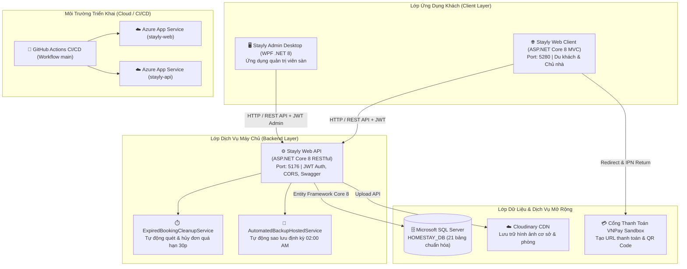

# 🏡 STAYLY — HỆ SINH THÁI QUẢN LÝ & ĐẶT PHÒNG HOMESTAY TOÀN DIỆN

> **ĐỒ ÁN TỐT NGHIỆP / BÁO CÁO MÔN HỌC CHUYÊN NGÀNH CÔNG NGHỆ THÔNG TIN**  
> **Kiến trúc hệ thống:** 3 phân hệ tích hợp chuẩn Doanh nghiệp (Web Khách hàng & Chủ nhà, Desktop Quản trị Admin, Backend RESTful API)  
> **Nền tảng công nghệ:** Đồng bộ trên toàn bộ giải pháp với **Microsoft .NET 8.0** & **C# 12**  
> **Cơ sở dữ liệu:** Microsoft SQL Server (`HOMESTAY_DB` — 21 bảng chuẩn hóa, 55+ cơ sở lưu trú cao cấp)

---

## 📌 Giới Thiệu Tổng Quan Đề Tài

**Stayly** là nền tảng công nghệ quản lý và đặt phòng Homestay / Khách sạn trực tuyến hiện đại, giải quyết toàn diện bài toán kết nối và vận hành giữa **3 nhóm đối tượng**:

1. **Khách hàng (Du khách / Guest):**
   - Khám phá điểm đến du lịch, lọc nâng cao theo tiện ích trọng điểm (Wifi, Điều hòa, Bể bơi, Bếp, Thú cưng) và thanh trượt khoảng giá.
   - Xem chi tiết cơ sở, bộ sưu tập ảnh chất lượng cao, chọn phòng và dịch vụ bổ sung (BBQ, tiệc trà, giặt ủi...).
   - Đặt phòng trực tuyến, áp dụng mã ưu đãi (Promo Code), thanh toán mã QR qua cổng VNPay Sandbox với bộ đếm thời gian thực 30 phút chống reset khi F5.
   - Theo dõi lịch sử chuyến đi, yêu cầu hủy đơn & hoàn tiền minh bạch, gửi đánh giá xếp hạng sao.

2. **Chủ cơ sở lưu trú (Host / Owner):**
   - Đăng ký hồ sơ cơ sở lưu trú mới kèm tệp minh chứng pháp lý (Giấy phép KD, Chứng nhận PCCC, ANTT).
   - Kênh quản lý tập trung (Host Dashboard): Theo dõi doanh thu, số lượng phòng và lịch sử đặt phòng.
   - **Chủ động bật / tắt hoạt động:** Nút công tắc thông minh kèm thẻ nhận diện trực quan (`status-approved` Đang hoạt động / `status-unavailable` Tạm dừng hoạt động).
   - Tiếp nhận và duyệt / từ chối đơn đặt phòng của khách; cấu hình danh mục dịch vụ bổ sung.

3. **Quản trị viên sàn (Platform Admin):**
   - Sử dụng ứng dụng **Desktop WPF** hiệu năng cao để vận hành toàn bộ hệ thống.
   - Thẩm định hồ sơ pháp lý cơ sở mới (xem ảnh tệp giấy phép, duyệt hoặc từ chối kèm lý do phản hồi).
   - Quản lý tài khoản người dùng, xem thông tin CCCD, khóa / mở khóa tài khoản vi phạm.
   - **Đối soát & quyết toán doanh thu:** Tự động phân chia tỷ lệ 85% tiền thực nhận cho chủ nhà / 15% hoa hồng sàn, ghi nhận mã giao dịch chuyển khoản ngân hàng.
   - Giám sát nhật ký hoạt động hệ thống (Audit Logs) thời gian thực.
   - **Trung tâm bảo trì & sao lưu CSDL:** Sao lưu nén tức thì, tải file `.bak` từ xa về máy, phục hồi CSDL tự động ngắt kết nối an toàn.

---

## 🏛️ Kiến Trúc Hệ Thống (System Architecture)



---

## 💻 Bảng Công Nghệ & Thư Viện Sử Dụng (Tech Stack)

| Phân hệ / Thành phần | Công nghệ sử dụng | Phiên bản | Vai trò & Mục đích |
| :--- | :--- | :--- | :--- |
| **Backend RESTful API** | ASP.NET Core Web API | .NET 8.0 | Xử lý toàn bộ logic nghiệp vụ, bảo mật, định tuyến API |
| **Truy cập dữ liệu (ORM)** | Entity Framework Core | 8.0.31 | Mapping bảng CSDL, LINQ queries, Migrations, Connection Pool |
| **Cơ sở dữ liệu** | Microsoft SQL Server | 2019/2022 | Lưu trữ dữ liệu quan hệ, thủ tục sao lưu/phục hồi T-SQL |
| **Web Client** | ASP.NET Core MVC | .NET 8.0 | Giao diện du khách đặt phòng và chủ nhà quản lý cơ sở |
| **Giao diện Web** | Razor Views, Bootstrap | 5.3.3 | Bố cục responsive, tối ưu mobile, styling chuẩn du lịch |
| **Desktop Admin** | Windows Presentation Foundation | .NET 8.0 | Ứng dụng Desktop cho Quản trị viên sàn (MVVM, XAML) |
| **Xác thực & Bảo mật** | JWT Bearer, PBKDF2 HMAC-SHA512 | .NET Identity | Cấp phát token, phân quyền theo vai trò, băm mật khẩu an toàn |
| **Cổng thanh toán** | VNPay Sandbox Gateway | API 2.1.0 | Tạo liên kết thanh toán và mã QR, chữ ký số HMAC-SHA512 |
| **Lưu trữ hình ảnh** | Cloudinary .NET SDK | v1.26+ | Tối ưu hóa dung lượng ảnh, lưu trữ đám mây và phân phối CDN |
| **Tự động hóa CI/CD** | GitHub Actions | Workflows | Tự động build, test và deploy lên Azure App Service khi push `main` |

---

## ✨ Điểm Nhấn Nghiệp Vụ & Kỹ Thuật Độc Đáo

### 1. Bộ Đếm Thời Gian Thực Tế 30 Phút Chống Reset Khi F5
- Khi tạo đơn đặt phòng, hệ thống ghi nhận chính xác mốc thời gian `NgayDat`.
- Giao diện thanh toán tính toán thời gian còn lại dựa trên `(NgayDat + 30 phút) - Giờ hiện tại`.
- **Tuyệt đối không bị reset về 30:00 khi F5/refresh trang** hay khi người dùng đóng trình duyệt và mở lại.
- Dịch vụ nền `ExpiredBookingCleanupService` tự động quét mỗi 30s để hủy đơn và giải phóng lịch phòng nếu quá hạn.

### 2. Quản Lý Trạng Thái Hoạt Động Cơ Sở Lưu Trú (Active Toggle & Status Pill)
- Tích hợp công tắc gạt bật/tắt hoạt động linh hoạt ngay trên từng card cơ sở của chủ nhà.
- Nhãn trực quan: **"Đang đón khách"** hoặc **"Tạm dừng"**.
- Thẻ trạng thái nhận diện rõ ràng:
  - `.status-approved` (Xanh ngọc): Đang hoạt động, mở bán công khai.
  - `.status-unavailable` (Xám Slate): Tạm dừng hoạt động, tự động ẩn khỏi trang tìm kiếm du khách.
  - `.status-pending` (Vàng hổ phách): Đang chờ Admin thẩm định pháp lý.
  - `.status-rejected` (Đỏ san hô): Bị từ chối (kèm lý do và nút *"Sửa & Gửi lại"*).
- Cập nhật thời gian thực qua AJAX/Fetch API mà không cần tải lại trang.

### 3. Mô Hình Tài Chính Đối Soát & Quyết Toán 85 / 15
- Hệ thống tự động trích 15% hoa hồng vận hành sàn và tính 85% tiền thực nhận cho chủ nhà (`TienThucNhanChu`).
- Admin đối soát danh sách đơn đã hoàn thành trên phần mềm WPF, kiểm tra số tài khoản ngân hàng của chủ nhà và ghi nhận mã giao dịch chuyển tiền.

### 4. Hệ Thống Sao Lưu & Phục Hồi CSDL Từ Xa
- Quản trị viên có thể kích hoạt sao lưu dữ liệu SQL Server có nén (`COMPRESSION`) trực tiếp từ ứng dụng WPF.
- Hỗ trợ tải tệp `.bak` từ máy chủ về máy cá nhân qua luồng HTTP an toàn.
- Hỗ trợ phục hồi CSDL với cơ chế ngắt các kết nối đang mở (`SINGLE_USER WITH ROLLBACK IMMEDIATE`).

---

## 👥 Danh Sách Tài Khoản Thử Nghiệm Mặc Định (Seed Accounts)

> 💡 **Tất cả các tài khoản thử nghiệm đều sử dụng chung mật khẩu mặc định:** `123123123`

| Phân hệ / Vai trò | Email đăng nhập | Mật khẩu mặc định | Họ tên hiển thị | Quyền hạn chính |
| :--- | :--- | :--- | :--- | :--- |
| **Quản trị viên (Admin)** | `admin@gmail.com` | `123123123` | Trần Nhật Trường | Toàn quyền thẩm định cơ sở, quyết toán, khóa tài khoản, sao lưu CSDL |
| **Quản trị viên dự phòng**| `admin@stayly.com` | `Admin@123456` | Admin Stayly | Tài khoản admin hệ thống dự phòng |
| **Chủ nhà mẫu 1 (Owner)** | `owner@gmail.com` | `123123123` | Chủ Cơ Sở Test | Quản lý Dalat Edensee Lake Resort, bật/tắt hoạt động, duyệt đơn |
| **Chủ nhà mẫu 2 (Owner)** | `an.nguyen@homestay.com`| `123123123` | Nguyễn Văn An | Quản lý Ana Mandara Villas Dalat Resort |
| **Khách hàng mẫu 1 (Guest)**| `guest@gmail.com` | `123123123` | Khách Thuê Test | Đặt phòng, quét QR thanh toán VNPay, xem chuyến đi, hoàn tiền, đánh giá |
| **Khách hàng mẫu 2 (Guest)**| `chi.le@gmail.com` | `123123123` | Lê Thị Chi | Đặt phòng và trải nghiệm dịch vụ |

---

## 🚀 Hướng Dẫn Cài Đặt & Khởi Chạy Từng Bước (A - Z)

### 1. Yêu Cầu Môi Trường
- Cài đặt [.NET 8.0 SDK](https://dotnet.microsoft.com/download/dotnet/8.0).
- Cài đặt Microsoft SQL Server 2019/2022 (hoặc SQL Server Express) và [SQL Server Management Studio (SSMS)](https://learn.microsoft.com/sql/ssms/download-sql-server-management-studio-ssms).
- Visual Studio 2022 (hoặc VS Code / JetBrains Rider).

---

### 2. Khởi Tạo Cơ Sở Dữ Liệu
1. Mở **SQL Server Management Studio (SSMS)** và kết nối tới SQL Server của bạn (ví dụ: `.` hoặc `localhost` hoặc `(localdb)\mssqllocaldb`).
2. Mở tệp script: `d:\Homestay\HOMESTAY_DB.sql`.
3. Nhấn **F5** (hoặc nút **Execute**).
   - *Script đã được viết thông minh: Tự động kiểm tra và tạo mới CSDL `HOMESTAY_DB` nếu chưa có, tự động tạo toàn bộ 21 bảng, chỉ mục tối ưu, và nạp sẵn 55+ khách sạn/homestay chất lượng cao.*

---

### 3. Cấu Hình Chuỗi Kết Nối (`API/appsettings.json`)
Kiểm tra tệp `API/appsettings.json` để đảm bảo chuỗi kết nối khớp với máy chủ SQL của bạn:
```json
{
  "ConnectionStrings": {
    "DefaultConnection": "Server=localhost;Database=HOMESTAY_DB;Trusted_Connection=True;TrustServerCertificate=True;"
  }
}
```
*(Nếu sử dụng SQL Authentication bằng tài khoản `sa`, thay đổi thành: `Server=localhost;Database=HOMESTAY_DB;User Id=sa;Password=YourPassword;TrustServerCertificate=True;`)*

---

### 4. Khởi Chạy Các Phân Hệ

#### Cách 1: Khởi chạy bằng Visual Studio 2022 (Khuyến nghị)
1. Mở tệp giải pháp [`Homestay.sln`](file:///d:/Homestay/Homestay.sln) bằng Visual Studio 2022.
2. Chuột phải vào Solution -> Chọn **Configure Startup Projects...** -> Chọn **Multiple startup projects**:
   - `API`: Start
   - `Web`: Start
   - *(Tùy chọn) `HomestaySystem` (WPF): Start*
3. Nhấn **F5** để khởi chạy đồng thời toàn bộ hệ thống!

#### Cách 2: Khởi chạy bằng dòng lệnh PowerShell / Terminal

**Cửa sổ 1 — Khởi chạy Backend API (Port 5176):**
```powershell
cd d:\Homestay\API
dotnet run --launch-profile http
```
- Swagger UI tài liệu API: `http://localhost:5176/swagger`

**Cửa sổ 2 — Khởi chạy Web Client (Port 5280):**
```powershell
cd d:\Homestay\Web\Web
dotnet run --launch-profile http
```
- Truy cập trình duyệt Web: `http://localhost:5280`

**Cửa sổ 3 — Khởi chạy Desktop Admin WPF:**
```powershell
cd d:\Homestay\Wpf\HomestaySystem
dotnet run --project HomestaySystem\HomestaySystem.csproj
```

---

## 📁 Cấu Trúc Thư Mục Dự Án (Folder Structure)

```
d:\Homestay\
│
├── API/                                 # Phân hệ Backend RESTful API (.NET 8.0)
│   ├── Controllers/                     # API Controllers (Auth, Properties, Bookings, Owner, Admin, Database...)
│   ├── Data/                            # HomestayDbContext, DbInitializer
│   ├── DTOs/                            # Data Transfer Objects cho Request/Response
│   ├── Migrations/                      # 5 bản Migrations chuẩn hóa của EF Core 8
│   ├── Models/                          # Thực thể Entity Framework (21 bảng quan hệ)
│   ├── Services/                        # Background Services, Backup/Restore, Email, Cloudinary...
│   ├── Program.cs                       # Cấu hình DI, JWT, Middleware, Hosted Services
│   └── appsettings.json                 # Cấu hình chuỗi kết nối, JWT Key, Cloudinary
│
├── Web/                                 # Phân hệ Web Client MVC (.NET 8.0)
│   └── Web/
│       ├── Controllers/                 # HomeController xử lý tương tác toàn bộ Web
│       ├── Models/                      # ViewModels & ApiModels
│       ├── Services/                    # HomestayApiClient kết nối Backend API
│       ├── Views/                       # Razor Views (Home, Details, Checkout, Trips, Dashboard...)
│       └── wwwroot/                     # Static assets (CSS site.css, JS, hình ảnh)
│
├── Wpf/                                 # Phân hệ Desktop Admin WPF (.NET 8.0)
│   └── HomestaySystem/
│       ├── HomestaySystem/
│       │   ├── Converters/              # XAML Value Converters
│       │   ├── Models/                  # Data Models quản trị
│       │   ├── Services/                # HttpAdminService kết nối API
│       │   ├── ViewModels/              # MVVM ViewModels
│       │   ├── Views/                   # XAML Views (KiemDuyet, QuanLy, QuyetToan, BaoTri...)
│       │   ├── App.xaml / MainWindow.xaml
│       │   └── HomestaySystem.csproj
│       └── HomestaySystem.sln
│
├── tools/                               # Công cụ hỗ trợ phát triển & dọn dẹp
│   ├── clean_solution.bat               # SCRIPT 1-CLICK DỌN DẸP BIN, OBJ, .VS ĐỂ NÉN NỘP ĐỒ ÁN
│   ├── check_kudu_deploy.py             # Script kiểm tra tiến trình deploy Azure Kudu
│   └── deploy_zip.py                    # Script tự động đóng gói ZipDeploy lên Azure
│
├── .github/workflows/                   # Quy trình tự động hóa CI/CD
│   └── azure-deploy.yml                 # GitHub Actions tự động build & deploy lên Azure
│
├── HOMESTAY_DB.sql                      # TỆP SCRIPT KHỞI TẠO TOÀN DIỆN CSDL (21 BẢNG, 55+ KHÁCH SẠN)
├── Homestay.sln                         # File Solution chứa toàn bộ 3 dự án (API, Web, WPF)
└── README.md                            # TÀI LIỆU HƯỚNG DẪN TỔNG THỂ DỰ ÁN
```

---

## 📦 Hướng Dẫn Dọn Dẹp & Nén Tổng Hợp Để Nộp Bài

Để đảm bảo tệp nén `.zip` đồ án **nhẹ nhất, sạch sẽ nhất (chỉ khoảng 15 – 25 MB thay vì hàng trăm MB do tệp build sinh ra)** và không gặp lỗi khi gửi qua LMS/Google Drive/Email:

1. **Đóng toàn bộ Visual Studio, VS Code và terminal đang chạy.**
2. Chạy tệp dọn dẹp tự động có sẵn trong thư mục `tools`:
   - Nhấp đúp chuột vào file: `d:\Homestay\tools\clean_solution.bat`
   - *Script sẽ tự động tìm và xóa sạch tất cả các thư mục tạm `bin`, `obj`, `.vs` trong toàn bộ solution.*
3. Chuột phải vào thư mục gốc `Homestay` -> Chọn **Compress to ZIP file** (hoặc dùng WinRAR/7-Zip chọn tệp `.zip`).
4. Tệp nén sau khi dọn dẹp chứa đầy đủ mã nguồn, tài liệu hướng dẫn và file script CSDL `HOMESTAY_DB.sql`, sẵn sàng nộp bài chấm điểm!

---

## 🌐 Thông Tin Triển Khai Thực Tế (Live Demo trên Cloud)

Hệ thống đã được đóng gói và triển khai thành công trên nền tảng đám mây **Microsoft Azure**:
- 🌐 **Web Ứng Dụng (Khách hàng & Chủ nhà):** https://stayly-web-bfayhhdkcqgva7cv.eastasia-01.azurewebsites.net
- ⚙️ **Backend RESTful API:** https://stayly-api-eebmfxd8cphdcegm.eastasia-01.azurewebsites.net
- 📖 **Swagger API Documentation:** https://stayly-api-eebmfxd8cphdcegm.eastasia-01.azurewebsites.net/swagger
- 🚀 **Quy trình CI/CD:** Tích hợp GitHub Actions, tự động kiểm thử và deploy mỗi khi có commit mới vào nhánh `main`.

---

*© 2026 Stayly Homestay Management Ecosystem. Đồ án môn học / Khóa luận tốt nghiệp chuyên ngành CNTT.*
